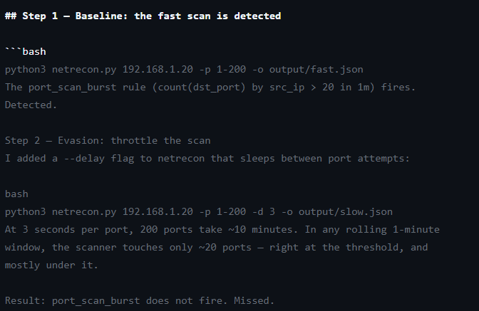

# purple-writeups

Attack walkthroughs paired with the detection logic that catches them.

Each entry follows the same loop: **execute → observe telemetry → confirm
the detection fires → note how to improve both sides.**

## Write-ups

| # | Title | Attack | Detection | ATT&CK |
|---|-------|--------|-----------|--------|
| 001 | [Port scan with netrecon](writeups/001-netrecon-portscan/) | `netrecon` | `port_scan_burst` | T1046 |
| 002 | [SSH brute force](writeups/002-ssh-bruteforce/) | `hydra` | `ssh_bruteforce` | T1110.001 |
| 003 | [Slow scan evasion](writeups/003-slow-scan-evasion/) | `netrecon --delay` | `slow_scan` | T1046 |

## Example

[Write-up #003](writeups/003-slow-scan-evasion/) shows the full
build → detect → evade → re-detect loop: a throttled scan that defeats
the fast-scan rule, and the slower rule that catches it.

## Why this exists
Running a tool proves you can follow steps. Pairing the attack with its
detection proves you understand the system from both sides — which is what
purple-team and detection-engineering roles actually require.
